<p align="center">
  
</p>

<p align="center">
  
</p>

<p align="center">
  
  
  
  
  
  
</p>

---

## 📖 About

**Travel Plan** is a cross-platform Flutter app that turns a few inputs (where from, where to, how many days, budget, vehicle and interests) into a **complete AI-generated road trip**: route stops, tourist spots, hotels, fuel/EV-charging stops, a cost estimate and safety tips. It also gives live weather along the route, an expense tracker with charts, a packing checklist and a budget splitter for group trips. Each user's plans and expenses are saved to Firebase.

---

## 🎬 App Demo

<p align="center">
  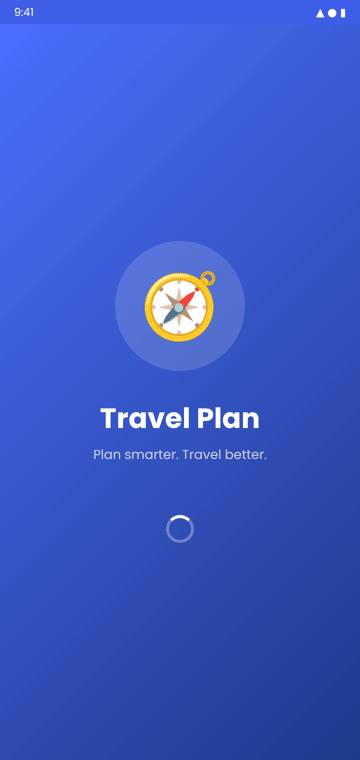
</p>

> 📌 **About the images:** the screenshots and the demo GIF are **UI previews** that recreate the app's screens (same layout, fields, labels and colours as the Flutter code). To use real device screenshots, run the app and replace the files in [`screenshots/`](screenshots/) using the same file names. The README updates automatically.

---

## 📸 Screenshots

### 1️⃣ Splash & Login
| Splash Screen *(new, animated)* | Login / Sign-up |
|:---:|:---:|
| 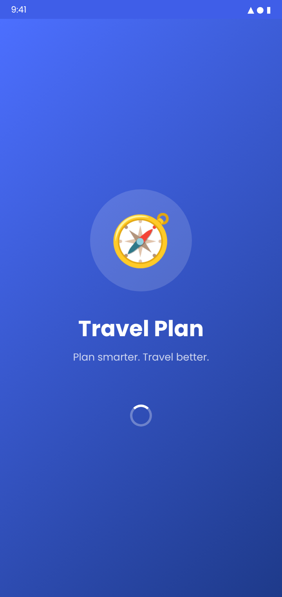 | 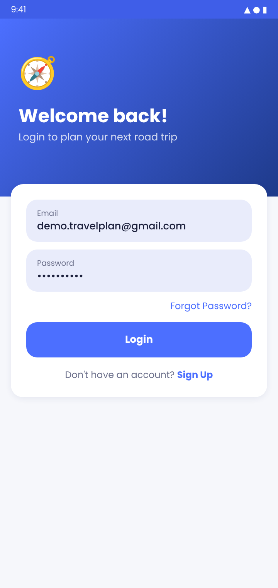 |
| Logo scales in with an elastic bounce, then title and tagline slide up and fade in before the app opens. | Email/password login with Firebase. Includes sign-up, email verification and OTP password reset. |

### 2️⃣ AI Trip Planner
| Plan Form | AI-Generated Plan |
|:---:|:---:|
| 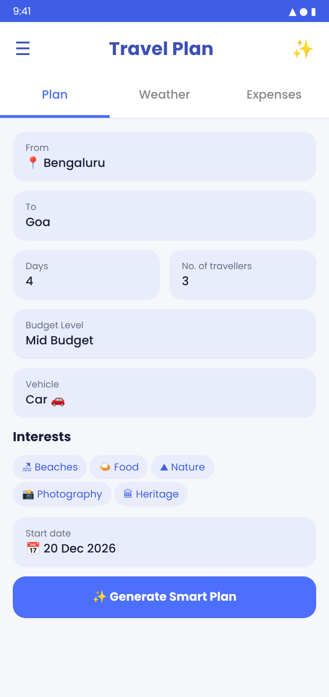 | 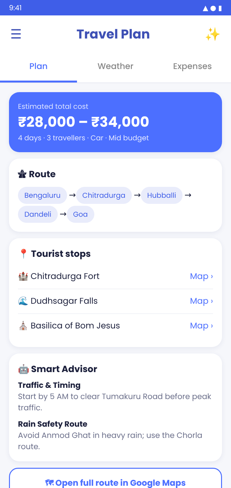 |
| Enter From (auto-detected by GPS), To, days, travellers, budget, vehicle, interests and start date. | Gemini returns the cost estimate, route, tourist stops, hotels, fuel/EV stops and Smart Advisor tips. Every place opens in Google Maps. |

### 3️⃣ Weather & Expenses
| Route Weather | Expense Tracker |
|:---:|:---:|
| 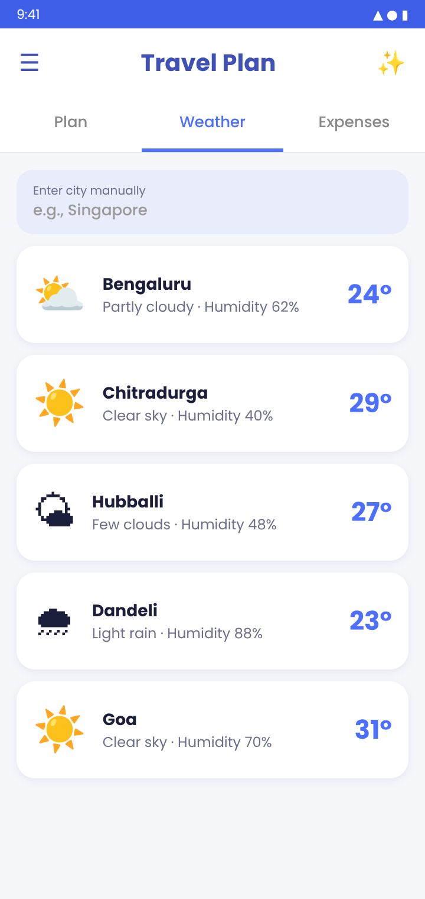 | 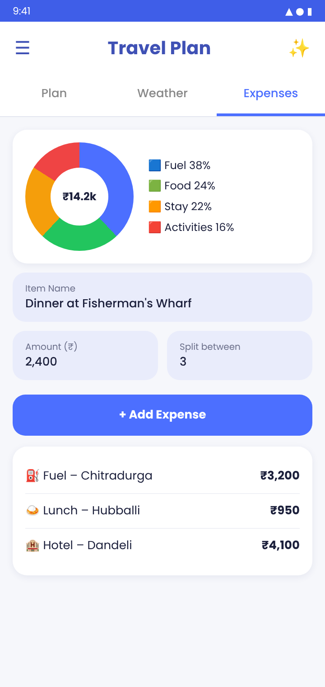 |
| Live temperature, conditions and humidity for every city on the route, plus manual city search. | Add expenses, split them between travellers, and see the spending breakdown in a chart. |

### 4️⃣ Suggestions & Travel Tools
| Trip Suggestions | Packing Checklist *(new)* | Budget Splitter *(new)* |
|:---:|:---:|:---:|
| 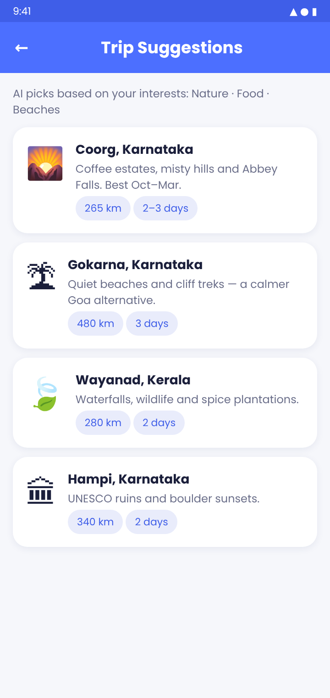 | 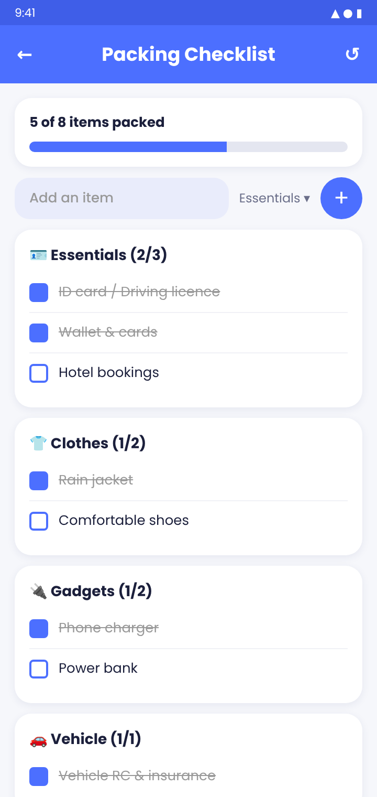 | 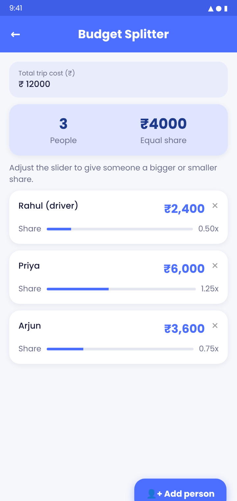 |
| AI-curated destination ideas that match your interests. | Category-wise checklist with an animated progress bar, swipe-to-delete, and saving on the device. | Split the total trip cost; sliders give each person a bigger or smaller share. |

---

## ⚙️ How the App Works

### 🔄 User flow

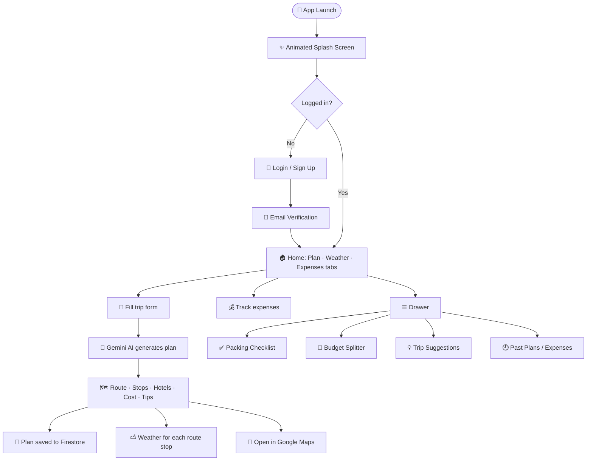

### 🧠 How the AI plan is generated

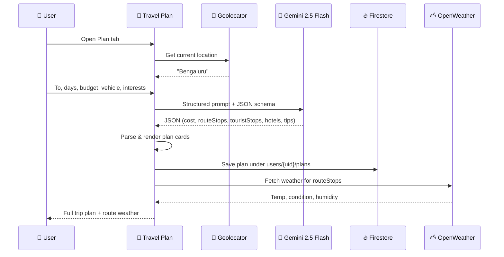

### 🪜 Step by step

1. **Launch:** the animated splash screen plays while Firebase starts up.
2. **Sign in:** `AuthWrapper` listens to `FirebaseAuth.authStateChanges()` and shows Login or Home.
3. **Plan:** the user's location is detected with **Geolocator + Geocoding** and filled into *From*.
4. **Generate:** the form builds a detailed prompt (budget rules, vehicle-specific fuel/EV logic, accommodation rules, safety and traffic advice) and asks Gemini to reply **only in a fixed JSON schema**.
5. **Display:** the JSON is parsed into cards for cost, route chips, tourist stops, hotels, fuel/charging stops and Smart Advisor tips. Tapping any place opens **Google Maps**.
6. **Save:** each plan is stored per user in **Cloud Firestore** and shown later under *History → Past Plans*.
7. **Weather:** the route stops are passed to the Weather tab, which fetches live data from **OpenWeatherMap**.
8. **Expenses:** items are added with amount and split, shown in an **fl_chart** breakdown and saved to history.
9. **Tools:** the Packing Checklist (saved on the device with `shared_preferences`) and the Budget Splitter (weighted shares) work offline.

---

## ✨ Features

| | Feature | Details |
|---|---|---|
| 🔐 | **Authentication** | Firebase email/password, email verification, OTP password reset |
| 🤖 | **AI Trip Planner** | Gemini 2.5 Flash, structured JSON output, budget-aware |
| 🚗 | **Vehicle-aware** | Bike / Car / EV, with fuel stations or EV charging stops |
| 💸 | **Cost Estimate** | Fuel, food, stay and activities in INR |
| 🛡️ | **Smart Advisor** | Rain-safety routes, traffic timing, budget tips |
| 📍 | **Auto Location** | GPS → city name |
| ⛅ | **Route Weather** | Live weather for every stop |
| 📊 | **Expense Tracker** | Category charts plus per-person split |
| 💡 | **Trip Suggestions** | AI destination ideas |
| ✅ | **Packing Checklist** 🆕 | Categories, animated progress, swipe-to-delete, saved on device |
| 👥 | **Budget Splitter** 🆕 | Equal or weighted shares per traveller |
| ✨ | **Animated Splash** 🆕 | Elastic logo, slide and fade text, fade transition |
| 🌗 | **Dark Mode** 🆕 | Material 3 theme that follows the system |
| 🕘 | **History** | Past plans and expenses per user |

## 🚀 What's new in v2.0

- ✨ **Animated splash screen** (`lib/screens/splash_screen.dart`)
- ✅ **Packing Checklist** (`lib/screens/packing_checklist_screen.dart`)
- 👥 **Budget Splitter** (`lib/screens/budget_splitter_screen.dart`)
- 🎨 **Material 3 redesign:** Poppins font, rounded inputs, floating snackbars, Cupertino-style page transitions
- 🌗 **Dark mode** support
- 🔒 **No secrets in code:** API keys come in through `--dart-define`; Firebase config is git-ignored
- 🧯 Friendly error when the Gemini key is missing
- 🏷️ Rebranded to **Travel Plan** on Android, iOS and Web
- 🧪 Replaced the broken default counter test

---

## 🏗️ Tech Stack

| Layer | Tech |
|---|---|
| UI | Flutter · Material 3 · Google Fonts (Poppins) |
| AI | `google_generative_ai`, Gemini 2.5 Flash |
| Auth & DB | Firebase Auth · Cloud Firestore |
| Location | `geolocator` · `geocoding` |
| Weather | OpenWeatherMap REST API (`http`) |
| Charts | `fl_chart` |
| Local storage | `shared_preferences` |
| Links | `url_launcher` (Google Maps) |

## 📁 Project Structure

```
lib/
├── main.dart                        # App entry, theme, home tabs, AI planner
├── config.dart                      # App name/version + API keys (dart-define)
├── auth_service.dart                # Firebase auth helpers
├── login_screen.dart                # Login · Sign up · OTP reset
├── weather_screen.dart              # Route weather
├── expense_tab.dart                 # Expense tracker + charts
├── expenses_history_screen.dart     # Past expenses
├── plans_history_screen.dart        # Past plans
├── trip_suggestions_screen.dart     # AI destination ideas
└── screens/
    ├── splash_screen.dart           # 🆕 Animated splash
    ├── packing_checklist_screen.dart# 🆕 Packing checklist
    └── budget_splitter_screen.dart  # 🆕 Budget splitter
screenshots/                         # README images, banner & demo GIF
env.example.json                     # Template for API keys
```

---

## 🛠️ Setup & Run

**1. Prerequisites:** Flutter 3.35+, a Firebase project (enable **Email/Password** auth and **Firestore**), a [Gemini API key](https://aistudio.google.com/app/apikey) and an [OpenWeatherMap key](https://openweathermap.org/api).

**2. Clone & install**
```bash
git clone https://github.com/nvaltryek-001/Travel_Plan.git
cd Travel_Plan
flutter pub get
```

**3. Connect Firebase**
```bash
dart pub global activate flutterfire_cli
flutterfire configure
```

**4. Add your API keys**
```bash
cp env.example.json env.json   # put real keys inside (git-ignored)
```

**5. Run / build**
```bash
flutter run --dart-define-from-file=env.json
flutter build apk --release --dart-define-from-file=env.json
```

**6. Test**
```bash
flutter test
```

---

## 🔑 Demo Login

Create this account once in **your** Firebase project (in-app **Sign Up**, or *Firebase Console → Authentication → Add user*):

| Field | Value |
|---|---|
| 📧 **Email** | `demo.travelplan@gmail.com` |
| 🔒 **Password** | `Travel@123` |

> If email verification blocks login during a demo, verify the address or add the user from the Firebase Console.

---

## 🗺️ Roadmap

- [ ] Offline map of the planned route
- [ ] Share a trip plan as PDF
- [ ] Multi-currency expense support
- [ ] Group trips with shared Firestore plans

## 🙏 Credits

Built on [smart_travel_app](https://github.com/itsvishwasj/smart_travel_app) by **itsvishwasj**, extended with new features, a redesigned UI, dark mode, secure key handling and full documentation.

<p align="center">Made with ❤️ and Flutter</p>
